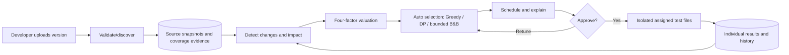

# TestOpt revised scope

The user-approved conversation revises the original SRS/UML/DFDs/algorithm document. Original PDFs are preserved. This addendum records changes; it does not claim the PDFs were edited.

Retain: change -> impact graph -> candidates -> four-factor valuation -> budgeted selection -> scheduling -> approval -> results -> history. Greedy, DP, optional bounded Branch and Bound; no Random. Run-all and static-priority remain baselines. Passing a subset does not prove every skipped test would pass.

| Original requirement | Agreed change |
| --- | --- |
| A-1, module/test management | Automatic discovery for supported projects, with manual review/import fallback. |
| A-2, REQ-4.5.1 | Compare uploaded versions and map changed files to modules; retain manual submission. |
| REQ-4.7.2 | Remove Random from the active design and evaluation. |
| REQ-4.7.4-5 | DP is exact only for fixed additive values within limits. Auto policy respects overlapping coverage. |
| Selection extension | B&B uses fixed additive values; disclose completed versus capped search. |
| REQ-4.11.3 | Saved preferences and explained automatic algorithm choice; advanced overrides remain. |
| REQ-4.8-4.9 | Actual outcomes at test-file granularity for the first upload adapter; preserve worker assignments and approval. |
| Section 5.2 | Strict budget; missing necessary checks produces incomplete validation rather than silently exceeding budget. |
| Time units | Positive fractional-minute measured estimates are supported; discretized exact methods must remain budget-feasible. This revises the whole-minute assumption. |
| History | Archive projects and retain snapshots, runs, and results. |

## First adapter and boundaries

Upload a folder containing package.json and dependency-free JavaScript with Node's built-in test runner. Test cases are test files, whose assertions execute together. Validate paths, limits, secrets, and supported file types before persistence. Inspection never runs code or installs packages. Execution uses disposable Docker containers with no network, a non-root user, read-only source/root filesystem, CPU/memory/process limits, and deadlines. Unsupported package dependencies/frameworks are disclosed; never silently execute them on the host.

First upload requires an approved full baseline. Subsequent uploads detect additions, modifications, and deletions. Imports and observed coverage inform impact. Missing coverage, dynamic resolution, configuration changes, new/deleted tests, and failing baselines broaden validation. Explain uncertainty. Greedy handles overlap; bounded DP handles small fixed-value cases; B&B remains an advanced override. Default scheduling is LPT. Tight budgets preserve incomplete status even when executed tests pass.

## UML/DFD addendum

Keep existing actors and strategy interfaces. Add ingestion before impact analysis and source/coverage stores. Replace Random branches with optional bounded B&B. Preserve explicit plan approval and result lifecycle.

## Acceptance

Upload supported fixture -> inspect discoveries -> approve baseline -> upload modified version -> inspect changed files and explained subset -> approve -> observe independent real results. Verify unrelated tests can be skipped with evidence, uncertainty broadens checks, tight budgets remain incomplete, timeout differs from test failure, archived history survives, and unsupported uploads never execute on the host.
