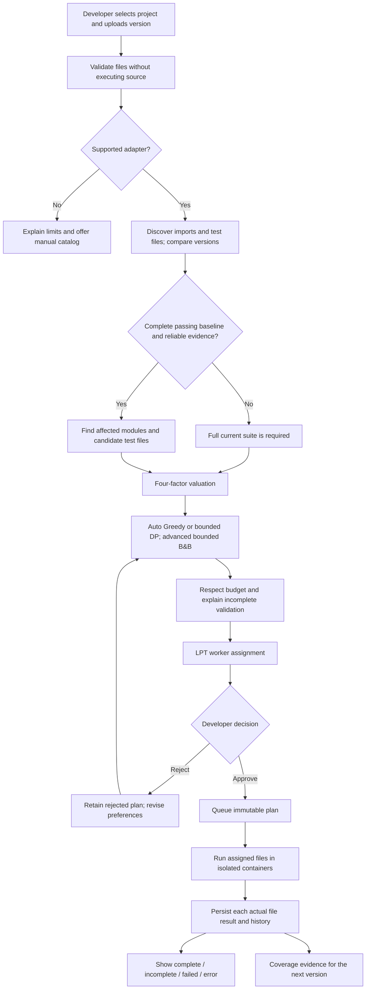
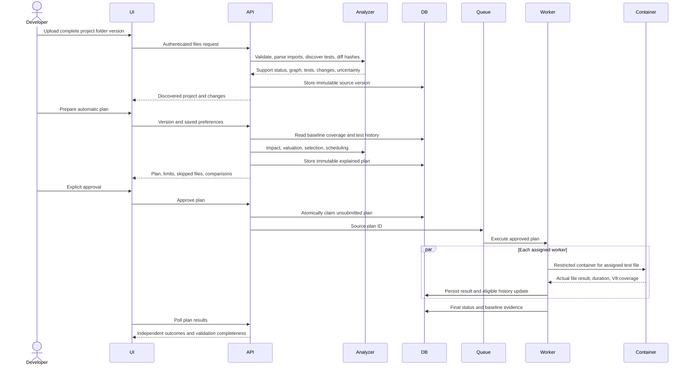
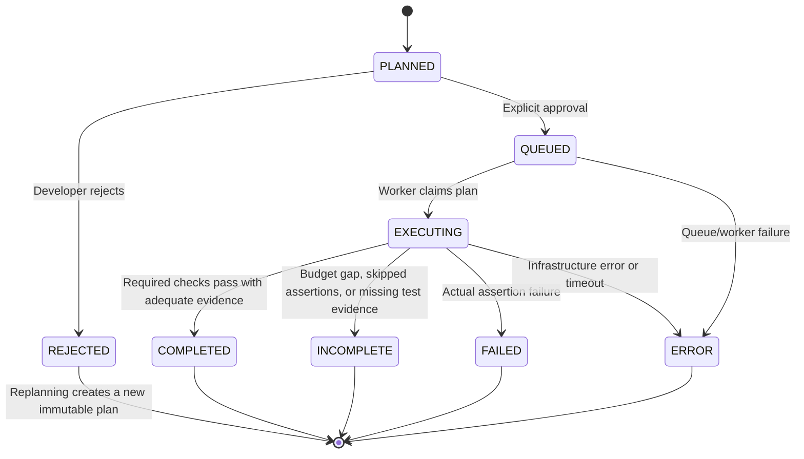
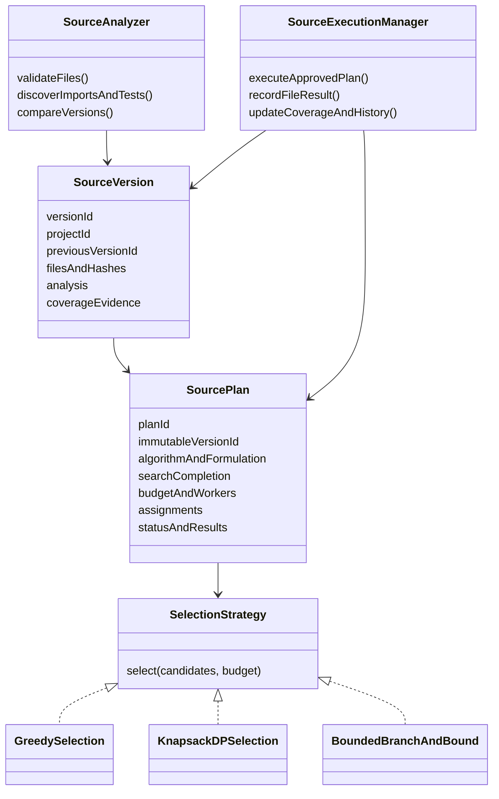
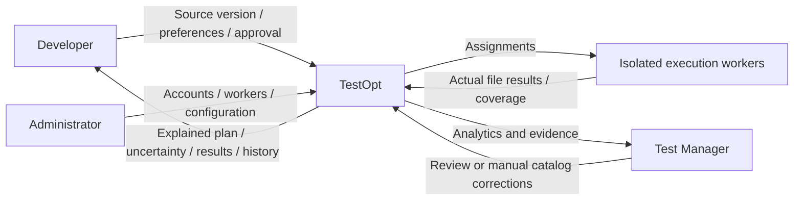
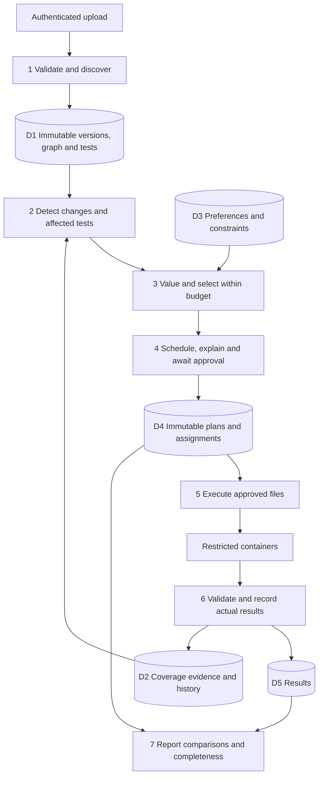

# TestOpt upload-first UML and DFD addendum

These diagrams revise the agreed ingestion/selection workflow while preserving the original actors, valuation, scheduling, approval, and feedback stages. Original PDFs remain unchanged. Random is removed; Branch and Bound is an optional bounded fixed-value selection strategy. SourcePlan/SourceVersion are the first adapter's persisted equivalents of the existing run/change/selected-test model; the manual catalog remains available.

## Activity

## Sequence

## State model

Actual file results are PASSED, FAILED, ERROR, or NOT_RUN. A source plan never converts a suite command's aggregate exit status into fictitious individual assertion results. Node assertions are grouped into a test-file unit. The existing manual simulation state machine is retained separately.

## Class/component responsibilities

The JavaScript implementation exposes pure strategy functions rather than introducing unrelated class wrappers; the diagram describes responsibilities and interchangeability.

## DFD context and decomposition

In the original Level 1 numbering, ingestion/discovery extends processes 2.0/3.0 before 4.0 impact analysis; automatic policy belongs in 5.1/5.3; scheduling remains 6.0; per-file dispatch/recording remains 7.0; comparisons/history remain 8.0. Existing account/configuration processes are retained. Repository-provider webhooks are deferred and are not represented as implemented actors.
